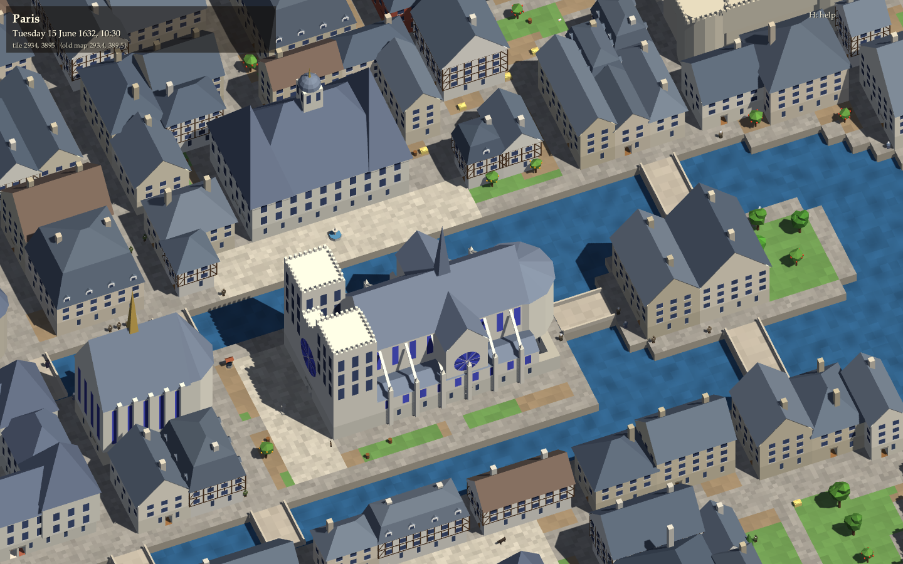
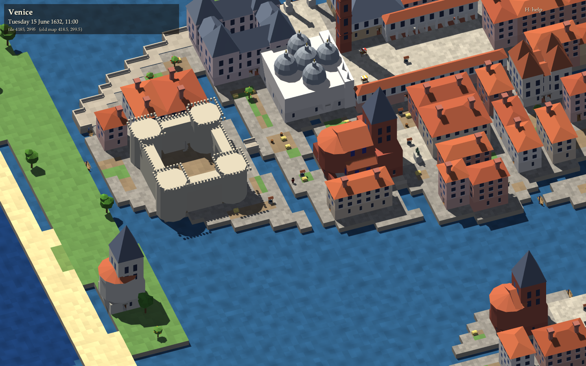
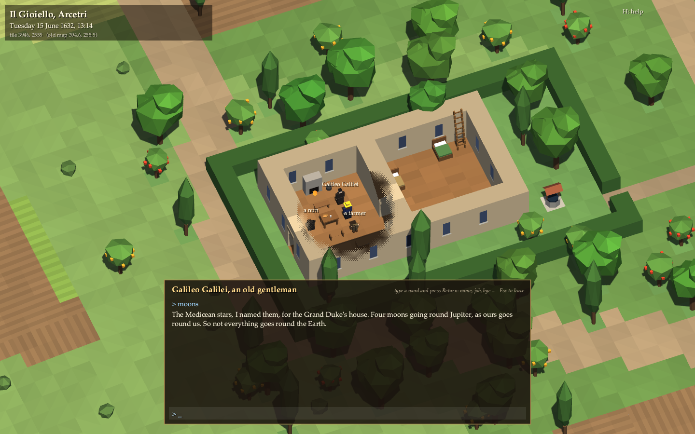
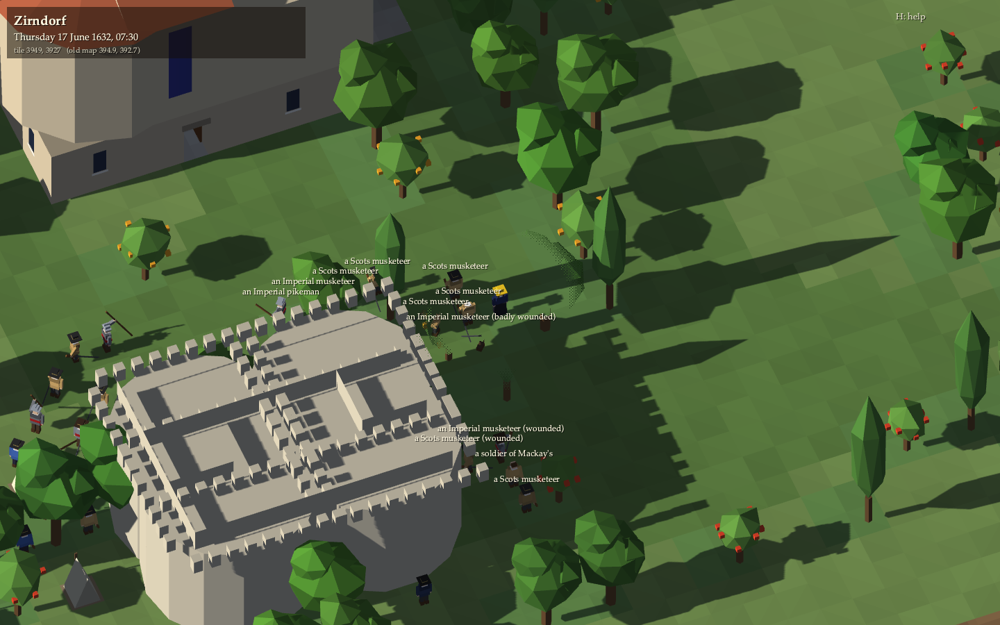
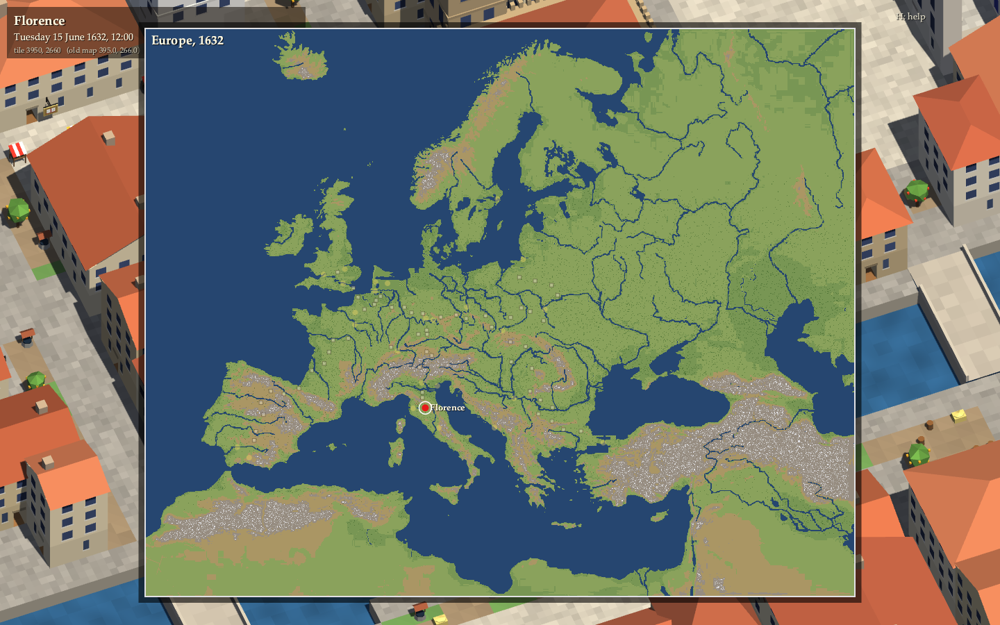
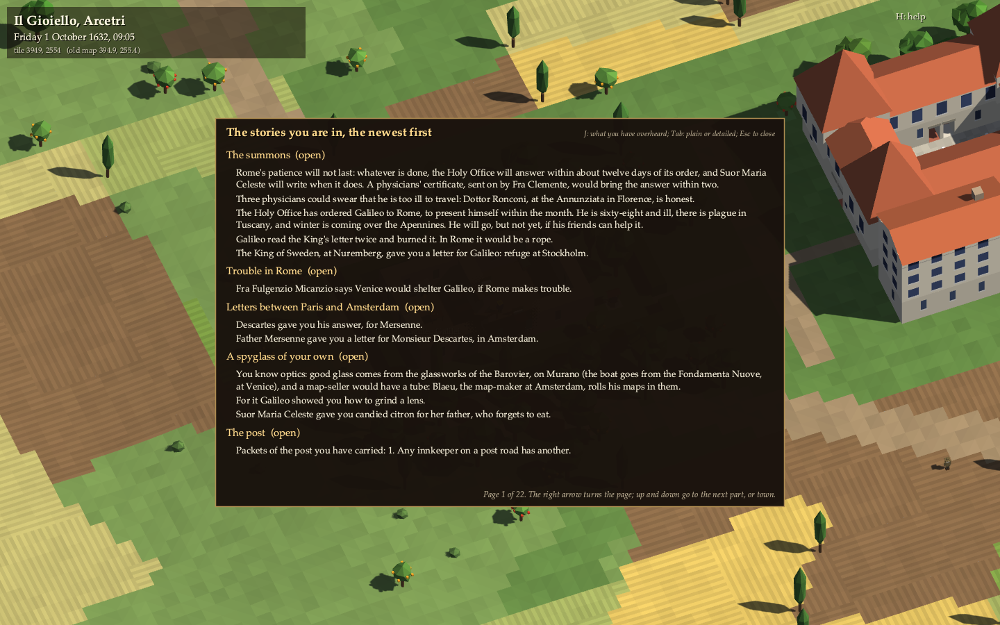

# Galileo

An Ultima-style role-playing game set in Europe from 1632 to 1638, drawn in low-poly 3D from an isometric-style
camera.

In the summer of 1632 Galileo's *Dialogue Concerning the Two Chief World Systems* has just been printed in Florence,
and Rome means to suppress it. You begin in Paris, a courier for the friar Marin Mersenne, and carry the book north,
out of the Inquisition's reach, into the hands of readers who will keep it; and then follow Galileo through the summons
to Rome, his trial, his years as a prisoner, and the printing of his last book, the *Two New Sciences*, in a prologue,
five chapters and an epilogue. On the way there is the siege of Nuremberg, where the King of Sweden holds the city and
Wallenstein the ridge of the Alte Veste above Zirndorf.

| | | |
|---|---|---|
|  |  |  |
| Paris: Notre-Dame and the Seine | Venice: San Marco and the lagoon | Arcetri: Galileo on the Medicean stars |
|  |  |  |
| Zirndorf: the storming of the Alte Veste | The map of Europe | The journal, at the start of Chapter II |

Twenty-six towns (Paris, Saint-Denis, London, Oxford, Cambridge, Florence, Pisa, Rome, Venice, Padua, Amsterdam,
Haarlem, Leiden, Constantinople, Ragusa, Seville, Granada, Zurich, Nuremberg, Zirndorf, Prague, Vienna, Cracow,
Danzig, Sarajevo, Stockholm) and the country between them make one map, with no loading between the streets, the
interiors and the open road. The people keep their own hours, talk with you in typed words, trade, remember what you
did, and talk to each other. You travel on foot, on horseback, by the post, by boat, ferry and ship.

This is an alpha version: the whole story can be played from the beginning to its ending. It runs on macOS only for
now.

Galileo is a game by Danny Calegari. The code of this version was written by Claude, an AI model made by Anthropic,
working with Danny Calegari, and is based in part on his earlier game (the 2013 alpha version, in this repository's
history). The design, the history and the story were worked out between them.

## Build and run (macOS)

    brew install glfw cairo pkg-config
    make
    ./galileo

It needs OpenGL 4.1. The sound uses Apple's AVFoundation (`src/audio.mm`, `src/sound.mm`) and the OpenGL header is
Apple's (`src/render.h`), which is why it builds on macOS only.

A new game begins with choosing who you are. The game saves itself when you quit (`saves/autosave.txt`) and continues
from there; `./galileo --new` starts afresh.

## Keys

| key | |
|---|---|
| arrows, WASD, keypad | walk (two keys together: diagonal); shift runs |
| U, then click a ladder | climb it (also stairs, trapdoors and shafts) |
| walk into a boat | get in and row; walk onto land to get out (a ferry boat: the ferryman takes you over) |
| T | talk to someone beside you: type a word and press Return (name, job, bye, ...); Esc leaves |
| in a conversation | buy, buy bread, sell candle, give book, give 2 sous, pay, bet 2 sous, bye |
| G, then click | get something within reach |
| L, then click | look at something (L twice: what is in front of you); a work of art opens its picture |
| C, then click | fight someone, or a wolf (C again: stop) |
| I | what you carry, and your money: a number chooses a thing, U uses it, D and a click puts it down |
| U, then click | use something: a bed, a bench, a well, an altar, an animal, your horse (get on or off), a deer or a wolf (shoot it, with a fowling piece and shot), water (fish, with a rod); U twice: something you carry (eat, drink, read) |
| J | the journal: the stories you are in, then what you have overheard |
| Q, E | turn the view |
| R, F | tilt the view |
| =, - or scroll | zoom |
| Z | reset the view |
| V | lift all the roofs, and put them back |
| M | the map of Europe |
| Ctrl+M | music off and on (`--no-music` starts without it) |
| K | sound effects off and on |
| P | screenshot, saved in `shots/` |
| H | help |
| Esc | close the map, or quit |

## Options

    ./galileo --help

`--testing` turns on the keys for testing: N travels to the next town, ] and [ move the clock an hour later or earlier,
and Tab gallops (fast travel). Other useful ones: `--town Rome` (and any other town), `--floor -2 --at 2960,3700` (the
quarries under Paris), `--time 21:30`, `--zoom 40`, `--bld 39` (start inside building 39; `--stats` lists the
buildings), and `--shot picture.png` to render one picture without opening a window. `./galileo --stats` builds the
world, checks that every street and building of each town can be reached on foot, and prints a summary.

## Testing

- `tools/play.sh SAVE "COMMANDS" [PICTURE.png]` plays the game by typed commands (walk to someone, talk, wait, travel,
  fight, look round), keeping the game in SAVE; `HELP` lists the commands.
- `tools/check.py` runs the checks: `./galileo --stats`, a lint of the story's data, and the scenarios of
  `tools/check/scenarios.txt` (each a few runs of `tools/play.sh` from a saved game in `tools/check/fixtures/`, with
  the lines its output must and must not contain). `--scenario NAME` runs one.

## Files

- `data/legacy/` the 1000 x 800 map of Europe from the 2013 Galileo.
- `data/world.txt` the towns, where they are, the roads between them, the hamlets, the start.
- `data/cities/*.map` one text map per town (one character per tile) with a legend of its landmarks; they can be edited
  by hand. `data/cities/hamlets/` farms, huts and quarries outside the towns.
- `data/styles.txt` the architecture of each town: colours, roofs, storeys.
- `data/people/` the people: `roles.txt` (professions: dress, work, day, talk; the file explains its own format),
  `names.txt`, one file per town, `plot.txt` (people of the story who live outside the towns), and `chats.txt` (conversations between people
  that you may overhear).
- `data/events.txt` what happens, and when: the story's events, their conditions and effects (the file explains its
  format). `data/stories.txt` the journal's stories; `data/cards.txt` the chapter and date cards; `data/ending.txt` the
  ending's pages; `data/scenes.txt` and `data/scenes/` the still scenes.
- `data/items.txt` things: the catalogue (names, shapes, weights, prices, what you see), where they lie, and works of
  art. `data/books/` the books you can read.
- `data/market.txt` and `data/coins.txt` prices, what each town wants, and its coins.
- `data/animals.txt` and `data/wild.txt` animals, and the dangers of the road (brigands, wolves, bears).
- `data/music.txt` the music: the recordings in `data/music/`, and the pieces that people play when something happens.
  Where each recording's notes come from: `data/music/CREDITS.txt`.
- `data/sounds.txt` and `data/sounds/` the sound effects (made by `tools/make_sounds.py`).
- `data/art/` pictures of the works of art, shown when you look at them, from Wikimedia Commons; each one's source and
  licence are in `data/art/CREDITS.txt`, and its credit is shown with it.
- `src/world.*` generating the land from the old map; queries on the world.
- `src/city.cc` reading a town map; cutting blocks into houses; building landmarks.
- `src/mesh.*` turning tiles and buildings into triangles.
- `src/render.*` OpenGL: shadows, light, water, the overlay.
- `src/audio.*`, `src/sound.*` music and sound effects, through Apple's AVFoundation (the `.mm` files are Objective-C++).
- `src/items.*` things: the catalogue, placing them, drawing them, saving what you changed.
- `src/animals.*` animals, wild and tame.
- `src/hud.*` the status line, the journal, the help and the map, drawn with cairo.
- `src/under.cc` tunnel networks (the quarries under Paris).
- `src/people.*` people: homes, work, days, route finding, memory, conversation, events, the journal.
- `src/main.cc` the game: walking, climbing, the view, the clock, fights, travel, keys, saving, and `tools/play.sh`'s
  commands.
- `tools/draft_towns.py` drew the town maps (running it again overwrites them: for Paris, Saint-Denis and London the
  .map files are the master copies; for the other towns the script is).

## Licence

The game (`src/`, `tools/`, `docs/`, and `data/` but for the pictures and the recordings) is free software under the
GNU General Public License, version 3: see `LICENSE`. The pictures in `data/art/` keep their own licences (public
domain, CC0, CC BY, CC BY-SA), given with each one in `data/art/CREDITS.txt`. The recordings in `data/music/` are
licensed CC BY 4.0, or CC BY-SA where the edition they come from requires it, as `data/music/CREDITS.txt` gives for
each.
